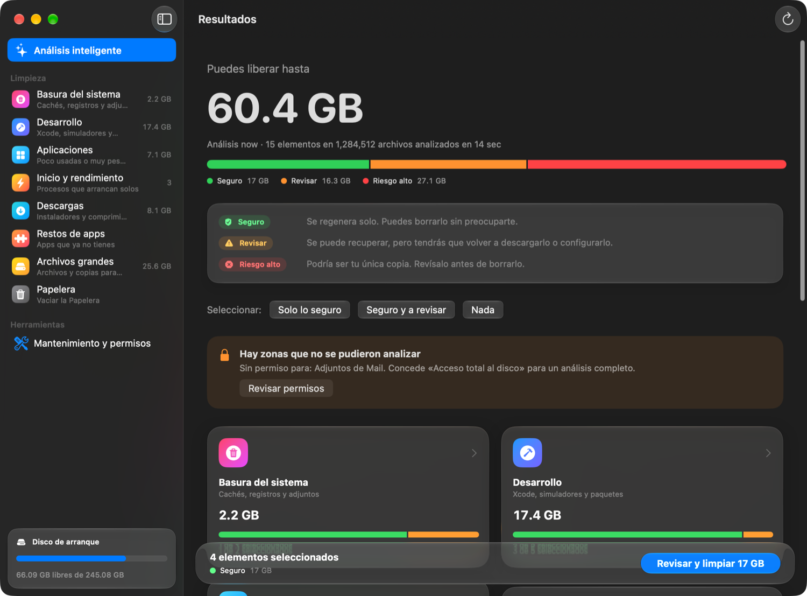
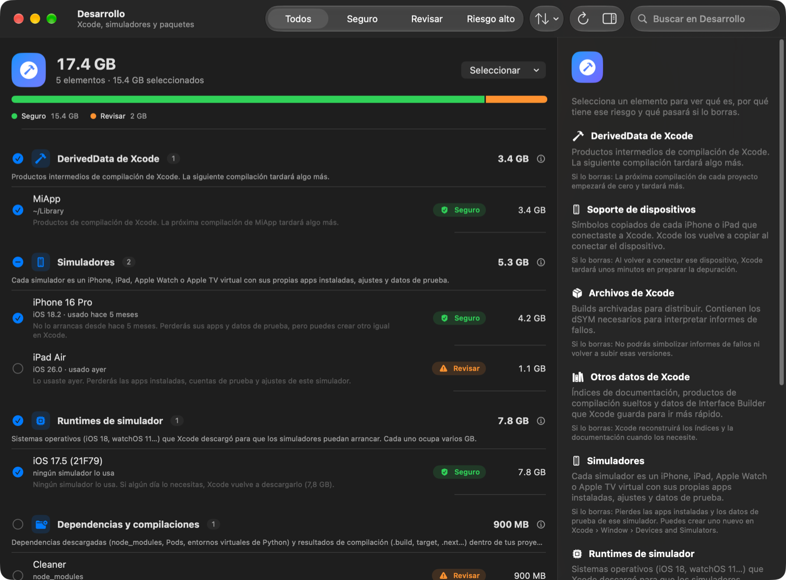
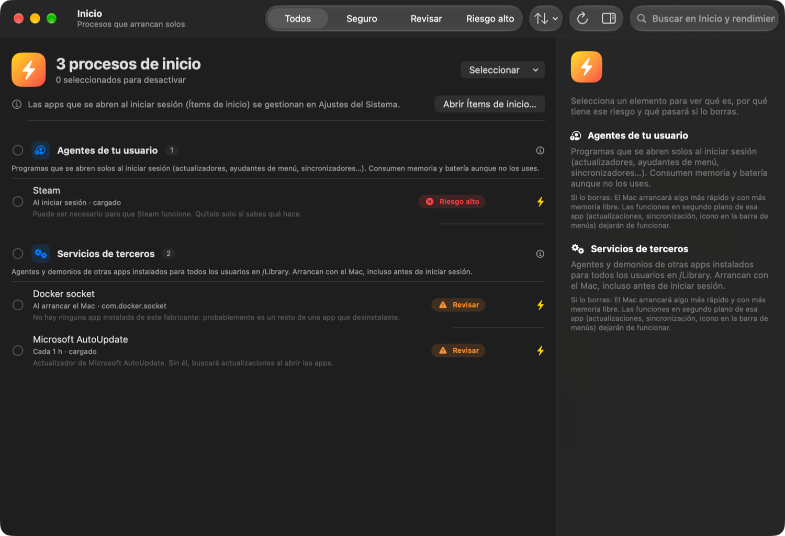
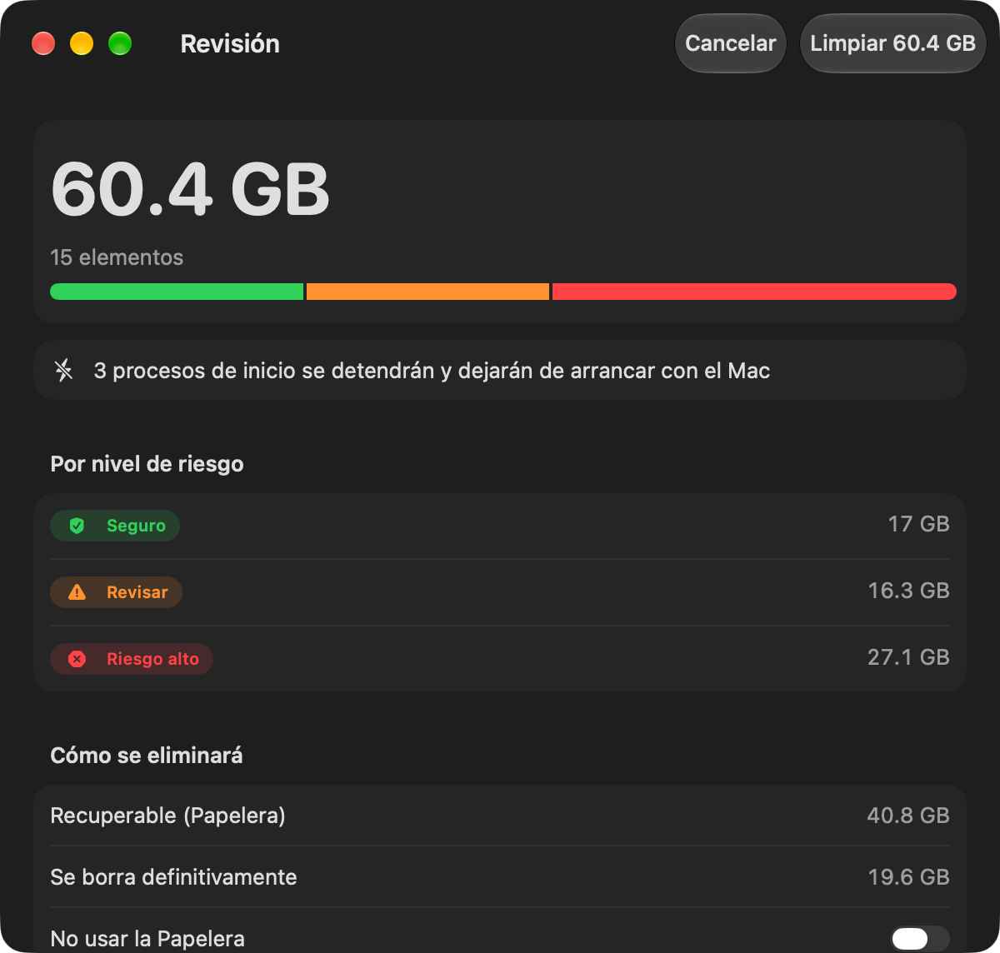

<p align="center">
  
</p>

<h1 align="center">MaCleaner</h1>

<p align="center">
  Limpieza profunda para macOS, iPadOS e iOS que te explica qué es cada cosa,<br>
  para qué servía y qué riesgo tiene borrarla. Nada se elimina sin que lo revises.
</p>

<p align="center">
  <a href="https://github.com/samueljuarezgordon/MaCleaner/releases/latest"><b>Descargar</b></a> ·
  <a href="docs/GUIA-MAC.md">Guía de Mac</a> ·
  <a href="docs/GUIA-IOS.md">Guía de iPhone y iPad</a> ·
  <a href="CHANGELOG.md">Novedades</a>
</p>

---



## Índice

- [En pocas palabras](#en-pocas-palabras)
- [Descargar e instalar](#descargar-e-instalar)
- [Mac](#mac)
- [iPhone y iPad](#iphone-y-ipad)
- [En todas las plataformas](#en-todas-las-plataformas)
- [Modelo de riesgo](#modelo-de-riesgo)
- [Privacidad y seguridad](#privacidad-y-seguridad)
- [Para desarrolladores](#para-desarrolladores)
- [Limitaciones conocidas](#limitaciones-conocidas)
- [Documentación](#documentación)

## En pocas palabras

1. **Analiza** lo que elijas: cachés, registros, Xcode y simuladores, apps que no usas, procesos de inicio, descargas, restos de apps, archivos grandes…
2. **Explica** cada elemento: qué es, por qué tiene ese riesgo, qué pasa si lo borras y cómo se eliminará.
3. **Selecciona solo lo seguro** por defecto. Lo de riesgo alto nunca se marca solo.
4. **Revisas** el desglose antes de borrar: qué va a la Papelera y qué se borra definitivamente.
5. **Limpia mostrando cada paso**: qué se está borrando, cuánto tarda, qué falló y por qué. Si algo se atasca, te dice qué suele retenerlo.

Todo ocurre en tu dispositivo, sin red ni telemetría.

## Descargar e instalar

Descarga la [última release](https://github.com/samueljuarezgordon/MaCleaner/releases/latest):

| Archivo | Para | Instalación |
|---|---|---|
| `MaCleaner-<versión>-macOS.zip` | Mac con Apple silicon, macOS 27 o posterior | Arrastra la app a Aplicaciones. Como aún no está notarizada, la primera vez: *Privacidad y seguridad › Abrir igualmente*. [Paso a paso](docs/GUIA-MAC.md#2-instalar-y-actualizar) |
| `MaCleaner-<versión>-iOS.ipa` | iPhone y iPad, iOS/iPadOS 27 o posterior (app universal, sin firmar) | Con Sideloadly o AltStore y tu Apple ID, o compilando con Xcode. [Paso a paso](docs/GUIA-IOS.md#3-instalar) |
| `SHA256SUMS.txt` | Comprobar las descargas | `shasum -a 256 -c SHA256SUMS.txt --ignore-missing` |

## Mac

| Módulo | Qué analiza |
|---|---|
| **Basura del sistema** | Cachés de usuario, de apps (Chromium/Electron) y del sistema, registros de usuario y del sistema, adjuntos de Mail. |
| **Desarrollo** | DerivedData, soporte de dispositivos, archivos de Xcode, otros datos de Xcode, **cada simulador y cada runtime** con su tamaño y último uso, cachés de paquetes (npm, pnpm, Gradle, Cargo, Go, Maven, NuGet, Conda…) y artefactos de proyectos (`node_modules`, `Pods`, `.build`, `target`, `.next`, `.venv`…). |
| **Aplicaciones** | Apps sin usar en 3 meses y apps de más de 1 GB contando sus datos. Se desinstalan con sus cachés, preferencias y contenedores. |
| **Inicio y rendimiento** | Agentes y servicios de terceros que arrancan solos: huérfanos, restos de apps desinstaladas, actualizadores, procesos siempre activos. |
| **Descargas** | Instaladores (`.dmg`, `.pkg`, `.ipsw`…) y comprimidos. |
| **Restos de apps** | Datos de apps que ya no están instaladas. |
| **Archivos grandes** | Archivos personales de más de 500 MB y copias de iPhone/iPad. |
| **Papelera** | Lo que ya está en la Papelera. |

**Mantenimiento**, con estimación antes y medición real después: purgar instantáneas locales de Time Machine, eliminar simuladores y runtimes inutilizables, restablecer los simuladores, reconstruir LaunchServices y restablecer Vista rápida. Cada acción muestra el paso en curso, el tiempo y lo que la bloquea (por ejemplo, una copia de Time Machine en curso).

**Permisos**: con *Acceso total al disco* el análisis es completo; con el **asistente privilegiado** se pueden borrar cachés y registros del sistema, purgar instantáneas y quitar servicios de `/Library`. *Diagnosticar el asistente* comprueba toda la cadena y dice en qué punto falla.

Guía completa, pantalla por pantalla: **[docs/GUIA-MAC.md](docs/GUIA-MAC.md)**.

| Desarrollo: simuladores y runtimes | Inicio y rendimiento | Revisión antes de limpiar |
|---|---|---|
|  |  |  |

## iPhone y iPad

Misma interfaz, centrada en lo único que el sandbox de iOS deja hacer de verdad con los *Datos del sistema*: **conseguir que iOS los purgue**.

| Dónde | Qué hace |
|---|---|
| **Basura del sistema** | **Datos del sistema purgables**: cachés de otras apps y de Safari, temporales, streaming, restos de actualizaciones y, con *Optimizar almacenamiento*, los originales de Fotos que ya están en iCloud. MaCleaner pide a iOS más espacio del que hay libre y iOS los purga por oleadas. **No se borra ninguna foto ni documento.** También limpia la caché de MaCleaner. |
| **Mantenimiento y consejos** | La purga con un objetivo (1, 5, 10 o 20 GB, o todo lo posible), consejos de lo que solo se hace desde Ajustes y una guía para desinstalar apps pesadas sin perder sus datos. |

La Fototeca, iCloud Drive y los archivos grandes están desactivados desde la 1.1.0.

Guía completa, con cómo funciona la purga y qué no puede hacer ninguna app en iOS: **[docs/GUIA-IOS.md](docs/GUIA-IOS.md)**.

## En todas las plataformas

- **Qué analizar**: activa o desactiva módulos y categorías. Puedes volver a analizar un módulo suelto sin perder el resto.
- Cada elemento muestra su **riesgo**, **por qué**, **qué pasa si lo borras** y **cómo se elimina**.
- **Revisión antes de limpiar** con desglose por riesgo, lo recuperable y aviso de lo de riesgo alto.
- **Ignorar siempre** para ocultar elementos en futuros análisis.
- Búsqueda, filtro por riesgo, orden por tamaño, nombre, fecha o riesgo, y menú contextual.

## Modelo de riesgo

| Nivel | Significado | Selección por defecto |
|---|---|---|
| 🟢 **Seguro** | Se regenera solo. Borrarlo no tiene consecuencias visibles. | Sí |
| 🟠 **Revisar** | Recuperable, pero con coste: volver a descargarlo, compilar o configurar. | No |
| 🔴 **Riesgo alto** | Puede ser tu única copia o necesario para que algo funcione. | Nunca |

Las reglas que asignan cada riesgo, categoría por categoría: [docs/CATEGORIES.md](docs/CATEGORIES.md).

## Privacidad y seguridad

- **Sin red**: ni peticiones, ni telemetría, ni cuentas.
- **Nada sin revisión**: toda limpieza pasa por la hoja de revisión.
- **Recuperable cuando tiene sentido**: instaladores, apps, restos y archivos personales van a la Papelera.
- **Asistente privilegiado mínimo** (solo Mac): solo acepta a MaCleaner firmada por el mismo equipo, revalida en cada operación, solo borra dentro de una lista cerrada de carpetas y se cierra solo cuando no se usa. Detalles en [docs/SECURITY.md](docs/SECURITY.md).

## Para desarrolladores

| | Versión |
|---|---|
| Xcode | 27 o posterior |
| macOS / iOS / iPadOS (destino) | 27.0 |
| Swift | 6 (aislamiento por defecto en `MainActor`) |

1. Abre `Cleaner.xcodeproj` y elige el esquema **MaCleaner**.
2. En *Signing & Capabilities*, elige tu equipo en los targets **MaCleaner** y **CleanerHelper**. El asistente exige firma con Team ID: con firma ad hoc rechaza todas las conexiones.
3. Elige *My Mac* o un dispositivo iOS y pulsa ⌘R.

Para distribuirla, sustituye el identificador de ejemplo `com.tuempresa.Cleaner` en `PRODUCT_BUNDLE_IDENTIFIER` (ambos targets), `Cleaner/SharedXPC/HelperConstants.swift` y `LaunchDaemons/com.tuempresa.Cleaner.Helper.plist` (nombre, `Label` y `MachServices`).

```
Cleaner/
├── MaCleanerApp.swift            Punto de entrada, menús y escena de Ajustes
├── ContentView.swift             NavigationSplitView y barra lateral
├── Shared/
│   ├── Domain/                   Categorías, riesgo, métodos de borrado, contrato del motor
│   ├── Presentation/             CleanerViewModel, preferencias y vistas compartidas
│   └── Concurrency/              Métricas, ResumeOnce y esperas cancelables
├── Platforms/
│   ├── macOS/
│   │   ├── Scanner/              Escáner de disco (getattrlistbulk) y recolectores
│   │   ├── Developer/            Simuladores y reparaciones del sistema
│   │   ├── Privileges/           Acceso total al disco, instalación, cliente XPC y diagnóstico
│   │   ├── MacCleaningEngine.swift
│   │   └── MaintenanceView.swift
│   └── iOS/                      Purga de Datos del sistema, mantenimiento y consejos
└── SharedXPC/                    Protocolo, constantes y validación compartidos con el asistente
CleanerHelper/                    Demonio privilegiado (root): listener XPC, servicio y cierre por inactividad
LaunchDaemons/                    launchd.plist del demonio (SMAppService)
Tools/make-icon.swift             Generador del icono
docs/                             Guías y documentación técnica
```

Arquitectura, contribución y cómo se publica una release: [ARCHITECTURE.md](docs/ARCHITECTURE.md) y [CONTRIBUTING.md](CONTRIBUTING.md).

## Limitaciones conocidas

- **Notarización**: la app de Mac está firmada con un certificado de desarrollo pero no notarizada; macOS avisa la primera vez.
- **Último uso de las apps**: viene de Spotlight (`kMDItemLastUsedDate`). Si no lo tiene, se usa la última modificación de los datos de la app.
- **Ítems de inicio de sesión** (`SMAppService` de otras apps): no hay API pública para listarlos; se abren los Ajustes del Sistema.
- **Instantáneas de Time Machine**: macOS decide cuánto libera; la cifra es un máximo. Las instantáneas de actualizaciones de macOS no se purgan.
- **Apps propiedad de root**: pueden pedir la contraseña al moverse a la Papelera.
- **iOS/iPadOS**: el sandbox impide ver datos de otras apps. La purga depende de lo que iOS decida liberar: justo después de otra purga o de reiniciar puede no liberar nada. La IPA va sin firmar y no está en el App Store.
- **No ejecutes la purga en el simulador de iOS**: su disco es el del Mac.

## Documentación

| Para | Documento |
|---|---|
| Usar la app de Mac | [Guía de Mac](docs/GUIA-MAC.md) |
| Usar la app de iPhone y iPad | [Guía de iPhone y iPad](docs/GUIA-IOS.md) |
| Saber qué analiza cada categoría y por qué tiene su riesgo | [Catálogo de categorías](docs/CATEGORIES.md) |
| Instalar, reinstalar o diagnosticar el asistente | [Asistente privilegiado](docs/HELPER.md) |
| Entender las garantías de seguridad | [Seguridad](docs/SECURITY.md) |
| Entender el código | [Arquitectura](docs/ARCHITECTURE.md) |
| Contribuir o publicar una release | [Cómo contribuir](CONTRIBUTING.md) |
| Ver qué ha cambiado | [Historial de cambios](CHANGELOG.md) |

## Licencia

Todavía no se ha elegido una licencia. Hasta entonces, todos los derechos están reservados.
